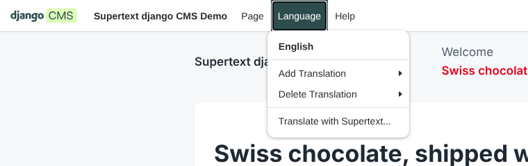
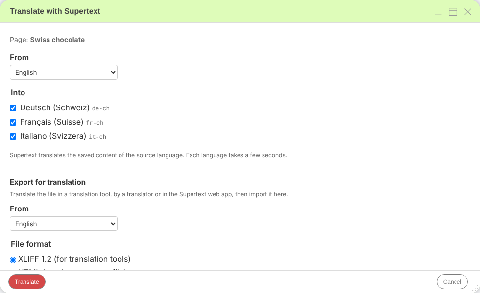
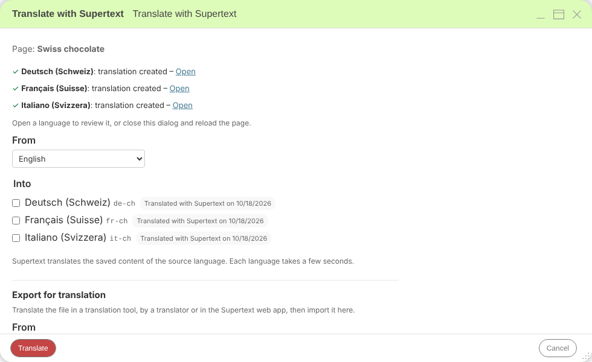
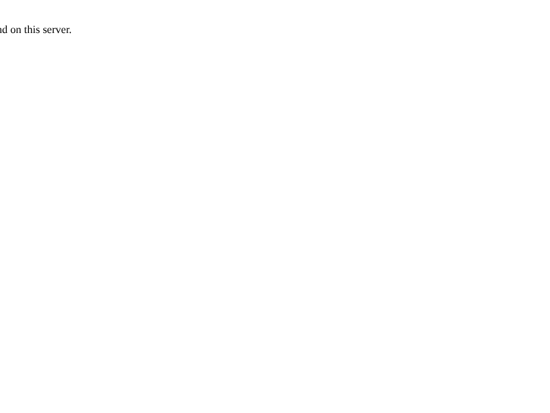
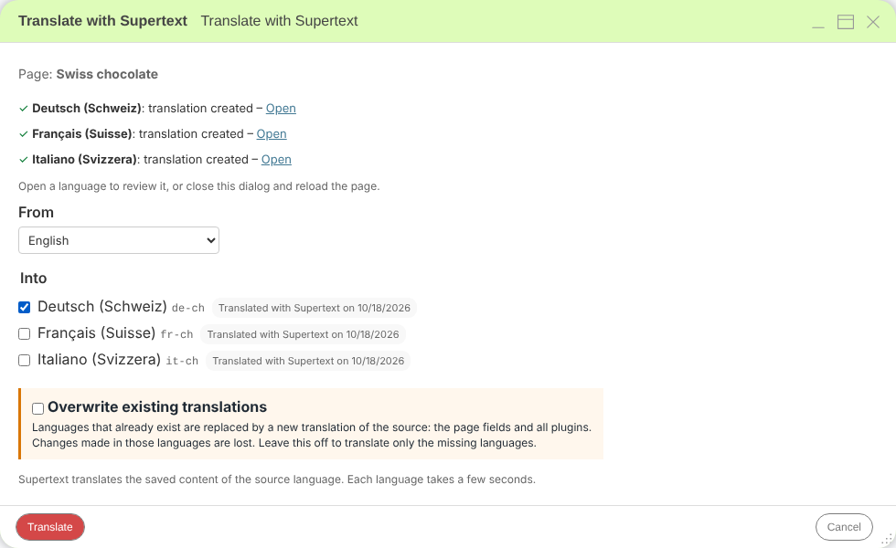
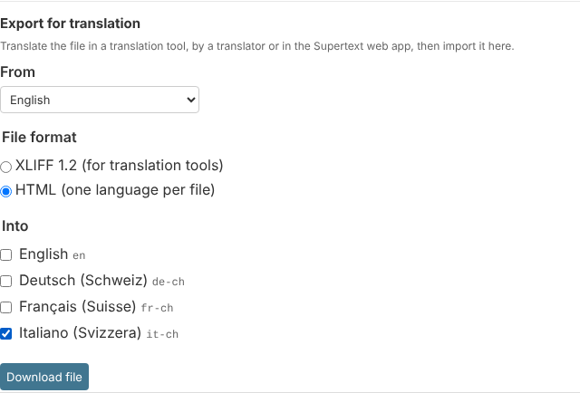
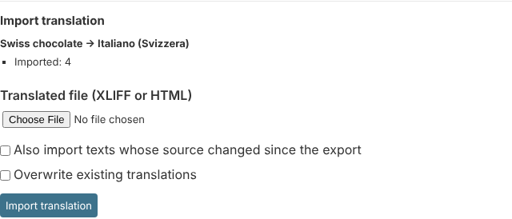
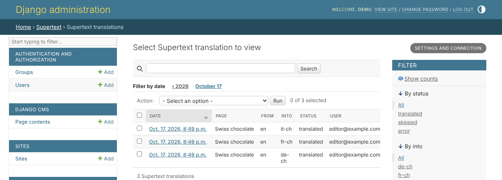

# User guide — Supertext Translation for django CMS

For editors who translate pages with the django CMS toolbar. Your administrator has installed the package and set up the site's languages (see the [installation guide](INSTALLATION.md)).

## Translate a page

1. Open the page in the language you translate **from** (usually English) and switch to **edit mode** (pencil button in the toolbar).
2. Make sure your changes are saved (and, with versioning, that the content you want to translate is the latest version). Supertext translates the saved content.
3. Open the **Language** menu in the toolbar and choose **Translate with Supertext…**.

   

4. In the dialog:
   - **From**: the language to translate from. Only languages the page exists in are offered.
   - **Into**: the languages to create. Languages the page doesn't exist in yet are ticked.
5. Click **Translate**.

Each language takes a few seconds. The dialog then lists the result per language, with an **Open** link to each new version:

## Review the translation

Click **Open** (or switch the language in the toolbar). The translated version is a normal django CMS page content: its title, page title, menu title, meta description and URL slug are translated, and all plugins of the source were copied with their texts translated. Rich text keeps its headings, bold text, links and lists.

Change what you like in edit mode, as if you had translated by hand. With djangocms-versioning, new languages are created as **drafts**: review and publish them as usual.

**Translation review:** if your administrator turned on *Translation review* for a language, reviewers (your colleagues or Supertext linguists) check and correct the translations on the website. Their corrections come into django CMS the next time you translate the page into that language: after a review, translate it again with *Overwrite existing translations*. Texts reviewed once keep their corrected wording in later translations.

## Translate again or update a translation

Languages the page already exists in show **Already translated** or **Translated with Supertext on** *date*, and are not ticked. If you tick one, the dialog asks whether to overwrite it:

- Leave **Overwrite existing translations** off: those languages are skipped (*already translated, skipped*); only missing languages are created. Your edits are safe.
- Turn it on: the page fields of those languages are replaced with a new translation, and **all their plugins are replaced** by translated copies of the source's plugins. **Changes made in those languages are lost.** The URL slug of an existing language stays as it is.

With djangocms-versioning, a published language can only be overwritten through a draft: create a draft of it first.

## Export for translation and import translated files

Instead of translating through the Supertext API, you can download a page as a file, have it translated elsewhere and import the result. Both are at the bottom of the *Translate with Supertext* dialog (toolbar → *Language* → *Translate with Supertext…*):

**Export for translation**

1. Choose the language to translate **From** (a language the page exists in) and the **File format**:
   - **XLIFF 1.2 (for translation tools)**: one file for one or more languages. Choose this for translation tools such as Trados, memoQ or Phrase: formatting becomes protected tags that translators can move but not break.
   - **HTML (one language per file)**: exactly one language. You can upload it to Supertext's web app or give it to anyone who translates HTML. Translators must leave the file's head and the `data-st-id` attributes alone.
2. Tick the languages **Into** and click **Download file**. The file has the same texts an API translation sends (see *What is translated*). A page without text says *Nothing to translate.*

Send the file to your translator or translation agency, or upload it to Supertext's web app.

**Import translation**

1. Under **Import translation**, choose the translated file (XLIFF or HTML, at most 10 MB). The file says which page and language it belongs to, so you can import it from the dialog of any page.
2. As with API translations, a language the page already exists in is only replaced with **Overwrite existing translations** (its page fields and all its plugins, see above; with djangocms-versioning only a draft). Tick **Also import texts whose source changed since the export** if texts edited in the source language after the export should still be imported (off by default).
3. Click **Import translation**. The language is created (a draft with djangocms-versioning) like an API translation: page fields, slug and copies of the source's plugins with the imported texts; texts that weren't imported keep the source's text.

The summary lists each page and language from the file:

| Line | Meaning |
| --- | --- |
| *Imported: n* | Texts written. |
| *Skipped, source changed since the export: n* | The source text was edited after the export; tick *Also import texts whose source changed since the export* to import them anyway. |
| *Not translated in the file: n* | The translator left these empty (XLIFF only). |
| *Formatting changed, not imported: n* | The translation broke or added formatting (tags, links); fix it in the file and import again. |
| *Not in the file: n* | Texts the page has now that weren't in the file (e.g. plugins added after the export). |

An HTML file can't mark a text as untranslated: imported unchanged, it writes the source text into the new language. Errors: *This file isn't a valid XLIFF or HTML translation file*, *This file wasn't exported by the Supertext plugin, or its header was removed*, *This file belongs to another system (…)* (exported by another Supertext plugin), *The page this file was exported from no longer exists*, *The site has no language …*, *Already translated.* (tick *Overwrite existing translations*), *The file is too large (at most 10 MB)*.

## What is translated

| Content | What happens |
| --- | --- |
| Title, page title, menu title, meta description | Translated |
| URL slug | Made from the translated title when a language is created; kept when overwriting |
| Text plugins | Translated as HTML: headings, bold, italic, links and lists stay in place, link addresses are kept |
| Link, Picture, File and Video plugins | Their text (link name, caption, file name, label) is translated |
| Other plugins | Copied into the new language unchanged (your administrator can add plugin fields to translate) |
| Page settings (template, menu visibility, …) | Copied from the source when a language is created |

Empty fields are skipped.

## The translation log

*Admin → Supertext → Supertext translations* lists every translation: page, languages, result, who started it and when.

## Messages

The Supertext dialog and its messages follow your django CMS interface language (English, German, French or Italian; *site name menu → User settings* in the toolbar).

| Message | Meaning |
| --- | --- |
| *Supertext is not set up yet: …* | No API key on the server. Ask your administrator; the message links to where they create a Supertext account and the API key. |
| *already translated, skipped* | The language exists and *Overwrite existing translations* was off. |
| *The page has no … version to translate from.* | Choose another *From* language. |
| *This language is published. Create a draft of it, then translate again.* | With versioning, overwrite a draft, not the published version. |
| *Authentication failed. Please check the Supertext API key.* | The API key is wrong. Ask your administrator. |
| *Your Supertext translation limit is exceeded.* | Your organisation's Supertext limit is used up. |
| *The language … has no Supertext language yet.* | Supertext has no obvious language for it (e.g. Irish English), and your administrator hasn't chosen one yet. Ask them to choose it under *Supertext → Supertext translations → Settings and connection → Languages*; nothing was sent for that language, the others are translated. |
| *Supertext does not support this language pair (en → …).* | Supertext can't translate between these languages (e.g. the same language on both sides), or a language code in the settings is wrong. Tell your administrator. |
| *Supertext offers no formal or informal tone for this language.* | The form of address set for that language isn't available in Supertext. Ask your administrator to set it to the default. |
| *Too many requests to Supertext. Please try again shortly.* | Supertext was busy; try again in a moment. |
| *Timed out waiting for the Supertext translation.* / *The Supertext service is currently unavailable.* | Supertext took too long or is unavailable. Try again later. |

Errors are shown per language: if one language fails, the others are still created.
